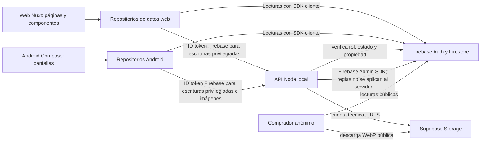

# 6. Capa de datos y carga de datos ficticios

## Arquitectura vigente



La API actual corre localmente en cada computador que realiza operaciones privilegiadas. El uso de una API local no elimina las reglas Firestore: las reglas protegen las lecturas/escrituras de los SDK cliente, y la API debe autorizar por sí misma las operaciones de servidor porque Firebase Admin las omite.

## Ubicación de cada acceso

| Parte | Archivos principales | Responsabilidad |
|---|---|---|
| Inicialización web | `web/app/plugins/firebase.client.ts`, `web/app/lib/firebase-local.ts`, `web/app/lib/firebase.ts` | Inicia el cliente local/emulador o el cliente compartido según el modo configurado. La inicialización no realiza consultas de negocio. |
| Repositorio Firestore común web | `web/app/repositories/firebase/cliente-firestore.ts` | Consulta acceso y catálogo, lee productos privados y guarda la selección de imágenes. Es el adaptador Firestore usado por los clientes local y compartido. |
| Composición de cliente web | `web/app/lib/cliente-local.ts`, `web/app/lib/cliente-compartido.ts`, `web/app/lib/cliente-base.ts` | Combina Auth, el repositorio Firestore y llamadas HTTP autenticadas a la API. `cliente-base.ts` conserva la interfaz existente, pero no construye consultas Firestore. |
| Administración web | `web/app/repositories/admin.ts`, `web/app/repositories/firebase/lecturas-admin.ts` | Lee metadatos permitidos desde Firestore y canaliza las mutaciones privilegiadas por la API. |
| Catálogo público web | `web/app/repositories/firebase/catalogo-publico.ts` y el contrato/modelos `web/app/repositories/catalogo-publico.ts`, `web/app/types/comprador-publico.ts` | Adapta las proyecciones Firestore al modelo comprador y resuelve las rutas públicas de imágenes Supabase. |
| Inicialización Android | `android/app-combinada/app/src/main/java/com/example/amancay/data/FirebaseClientServices.kt` | Configura Firebase Auth, Firestore y la API para la aplicación unificada. |
| Catálogo comprador Android | `android/app-combinada/app/src/main/java/com/example/amancay/data/CatalogoCompradorRepository.kt` | Escucha tiendas, productos, variantes y catálogos públicos de Firestore. |
| Cuenta/tienda emprendedora Android | `android/app-combinada/app/src/main/java/com/example/amancay/data/CuentaEmprendedoraRepository.kt` | Valida sesión, rol, tienda asignada y lee/edita la ficha conectada según las operaciones autorizadas. |
| Productos emprendedora Android | `android/app-combinada/app/src/main/java/com/example/amancay/data/ProductosEmprendedoraRepository.kt`, `ApiEmprendedoraClient.kt` | Lee borradores/datos propios desde Firestore y solicita a la API crear, editar, publicar, retirar, ajustar stock y procesar imágenes. |
| Contratos compartidos | `contratos/` | Define nombres de operaciones, campos, estados, validaciones e invariantes para que Android, web y API no inventen formas incompatibles. |

La revisión estática confirma que las consultas y escrituras Firestore del cliente web están en `web/app/repositories/`; los módulos de `lib/` inicializan/componen Firebase o conservan interfaces compatibles, pero las pantallas no consultan el SDK. En Android, las operaciones Firestore de la app unificada están bajo `android/.../data/`, no en las pantallas Compose. Para agregar una pantalla, consumir el plugin/repositorio existente y no importar `firebase/firestore` ni `FirebaseFirestore` desde la interfaz.

El backend Node también accede a Firestore desde módulos de servidor mediante Firebase Admin. Es una capa distinta de los repositorios cliente: Admin SDK omite las reglas, por lo que cada operación privilegiada valida identidad, rol, tienda y datos en la API antes de escribir.

### Comprobación estática de la separación

Desde la raíz del repositorio, estos comandos permiten revisar que la interfaz no incorpore consultas Firestore directas y ubicar las implementaciones en los repositorios/adaptadores:

```powershell
rg -n "firebase/firestore|FirebaseFirestore|addSnapshotListener|\.collection\(" web/app/pages web/app/components android/app-combinada/app/src/main/java/com/example/amancay/ui
rg -n "firebase/firestore|FirebaseFirestore|collection\(|getDocs\(|getDoc\(|addSnapshotListener" web/app/repositories android/app-combinada/app/src/main/java/com/example/amancay/data
```

El primer comando no debe encontrar acceso al SDK desde pantallas/componentes. El segundo muestra las consultas dentro de la capa de datos. La inicialización puede aparecer aparte en `web/app/lib/firebase*.ts` y `FirebaseClientServices.kt`; crear la conexión no es consultar datos.

## Datos ficticios: emuladores locales

Es el camino más simple y aislado. No necesita crear otro proyecto Cloud y nunca modifica `rincon-amancay`.

1. Desde la raíz, instalar herramientas Firebase si aún no están instaladas:

   ```powershell
   npm.cmd --prefix firebase ci
   ```

2. En una terminal dejar funcionando los emuladores:

   ```powershell
   npm.cmd --prefix firebase run emulators
   ```

3. En otra terminal cargar la fixture ficticia:

   ```powershell
   npm.cmd --prefix firebase run seed
   ```

La semilla fija el proyecto `demo-rincon-amancay`, verifica que Firestore escuche en `127.0.0.1:8080` y carga 29 documentos. No necesita credenciales. Al reiniciar emuladores, los datos desaparecen y se debe volver a cargar la semilla. Para cuentas locales de inicio de sesión y recorrido integrado, seguir [Arranque por equipo](../arranque-equipos.md); la semilla Firestore por sí sola no crea usuarios de Authentication.

`firebase/scripts/seed-cloud.mjs` rechaza la importación de la fixture. No cambiar esa barrera para poder usarla en el proyecto compartido.

## Datos ficticios: proyecto Firebase Cloud de desarrollo

Cuando se requiera mostrar lecturas y escrituras contra Firebase Cloud, usar un proyecto distinto del compartido. El cargador valida el destino y solo acepta IDs con el prefijo `rincon-amancay-dev-`; rechaza expresamente `rincon-amancay` y `demo-*`.

### Preparar el proyecto una vez

1. Crear en Firebase Console un proyecto separado con ID único, por ejemplo `rincon-amancay-dev-fixmol26`. No reutilizar el ID `rincon-amancay`.
2. Crear Firestore Database y habilitar Email/Password en Authentication. Si se probarán clientes, registrar una aplicación web/Android para este proyecto y usar sus archivos de configuración locales; no copiarlos al repositorio.
3. Conceder a la identidad local que ejecutará el seed permisos suficientes para crear usuarios de Authentication y escribir en Firestore en **este proyecto de desarrollo**. Usar ADC y no crear ni compartir claves JSON de cuentas de servicio.
4. Desde la raíz, desplegar las reglas e índices con el ID explícito del proyecto de desarrollo:

   ```powershell
   .\firebase\node_modules\.bin\firebase.cmd deploy --only firestore:rules,firestore:indexes --project rincon-amancay-dev-fixmol26
   ```

   Si se cambia el sufijo, reemplazar el ID de ejemplo por el ID real. El alias `development` de `.firebaserc` actualmente apunta a `rincon-amancay`; por seguridad, no usar ese alias para estos pasos.
5. Autenticar ADC con una identidad autorizada en el proyecto de desarrollo. El cargador rechaza si hay variables de emulador activas o si `GCLOUD_PROJECT`/`GOOGLE_CLOUD_PROJECT` apuntan a otro proyecto:

   ```powershell
   gcloud auth application-default login
   gcloud config set project rincon-amancay-dev-fixmol26
   ```

### Configurar y ejecutar la carga

1. Crear localmente `firebase/secrets/development.env`. La carpeta `secrets/` está excluida de Git. Completarla así; los correos deben terminar en `.test` y las claves son solo para esta instancia ficticia:

   ```ini
   AMANCAY_DEV_PROJECT_ID=rincon-amancay-dev-fixmol26
   AMANCAY_DEV_ADMIN_EMAIL=admin@rincon-amancay.test
   AMANCAY_DEV_ADMIN_PASSWORD=CLAVE_TEMPORAL_ADMIN_DE_12_CARACTERES
   AMANCAY_DEV_OWNER_EMAIL=emprendedora@rincon-amancay.test
   AMANCAY_DEV_OWNER_PASSWORD=CLAVE_TEMPORAL_EMPRENDEDORA
   ```

2. Desde la raíz, cargar datos y cuentas de prueba confirmando dos veces el destino:

   ```powershell
   npm.cmd --prefix firebase run seed:development -- --confirm-dev-project rincon-amancay-dev-fixmol26
   ```

La carga importa los 29 documentos de `datos-prueba/catalogo-local.json` y crea/actualiza dos cuentas ficticias con UID `u_admin_demo` y `u_emprendedora_demo`. Si las cuentas ya existen con esos UID/correos, se reinician sus contraseñas con las que se indiquen en el archivo local. Repetir la carga reemplaza únicamente las rutas de documentos de la fixture y no elimina otras colecciones ni archivos. Las claves no se imprimen.

El proceso usa Firebase Admin y, por ello, omite las reglas al escribir la fixture. Esto solo es aceptable porque el script restringe proyecto, rutas y tamaño de lote. Después de cargar, probar los clientes normalmente para confirmar que sus lecturas y escrituras respetan las reglas publicadas. Los productos ficticios no traen imágenes; para probar imágenes se necesita configurar por separado una ruta de desarrollo para Supabase y no usar archivos privados de personas.

Al terminar, cerrar la sesión de prueba y eliminar el proyecto Firebase dev si ya no se necesita. No ejecutar este seed en `rincon-amancay` ni mientras el backend local esté configurado para el proyecto compartido.

## Límites conocidos para presentar

- Los datos de `datos-prueba/catalogo-local.json` son plausibles pero ficticios, sin datos personales reales y sin imágenes.
- Las cuentas de prueba cloud llevan roles ficticios; nunca reutilizar esas claves en el proyecto compartido.
- Las escrituras privilegiadas requieren la API autenticada. Tener datos en Firestore no significa que la API o el almacenamiento de imágenes estén desplegados.
- Esta capa permite que web y Android compartan modelo/Firestore. No convierte las APIs locales en un servicio HTTPS público.
